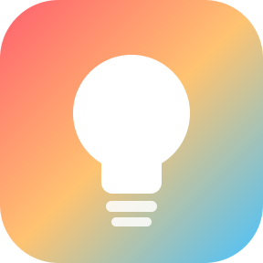
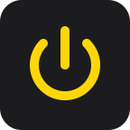
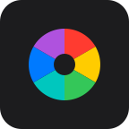
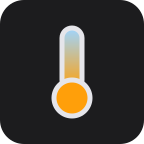
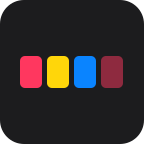
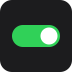
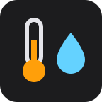
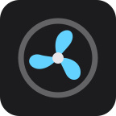

<p align="center">
  
</p>

<h1 align="center">Govee Control for OpenDeck</h1>

<p align="center">
  <b>Your Govee lights, scenes and appliances on your Stream Deck.</b><br />
  A native plugin for <a href="https://github.com/nekename/OpenDeck">OpenDeck</a>, the free and open-source Stream Deck app.
</p>

<p align="center">
  <a href="https://github.com/nnfisfree/govee-control-opendeck/releases/latest"></a>
  
  
  <a href="LICENSE"></a>
  <a href="https://github.com/sponsors/nnfisfree"></a>
</p>

---

## ✨ What it does

Govee Control turns Stream Deck keys and Stream Deck+ dials into controls for your Govee devices. Use a key to switch a lamp on, play a scene, colour each segment of a light strip, or read the temperature in the room. Turn a dial to dim the lights, move through colours or browse scenes, and watch the value on the touch strip.

It talks to Govee through the **official Govee cloud API** with your own free API key. It runs as **one small native program** on Linux, Windows and macOS, with no Node.js, Wine or other runtime to install.

- 🎛️ **12 actions** for lights, scenes, sensors and appliances, all usable on keys and on dials
- 👥 **Groups**: control several devices from one key, even different light models
- ⏱️ **Long press**: give any key a second action when you hold it
- 🔄 **Always in sync**: keys update straight away and pick up changes made in the Govee app or with a wall switch
- 📴 **Offline indicator**: a key shows when its device can't be reached
- 🔒 **Private**: your key stays on your computer, and the plugin talks only to Govee, with no telemetry

<sub><i>This project is not affiliated with, endorsed by or sponsored by Govee. "Govee" is a trademark of its owner and is used here only to describe compatibility.</i></sub>

## 💡 Supported devices

Any Govee device that appears in the **Govee developer API** works with this plugin: most Wi-Fi models, and Bluetooth sensors connected through a Govee gateway. Each device's settings list only the actions it supports, so you never pick an action that can't work.

| Device type | Examples | What you can do |
|---|---|---|
| **Wi-Fi lights** | Bulbs, floor and table lamps, ceiling lights, wall lights | Power, brightness, colour, white temperature, presets, cycles, scenes, snapshots |
| **RGBIC strips and bars** | LED strips, light bars, TV backlights, neon rope lights, outdoor string lights | Everything above, plus **segment colour**, **music mode** and DIY scenes |
| **Lights with extra features** | Models with a gradient, night light or DreamView (TV sync) | **Toggle** those features on and off |
| **Thermometers and hygrometers** | Indoor sensors connected to a Govee Wi-Fi gateway | Show **temperature and humidity** on a key or dial |
| **Heaters** | Space heaters and radiators | Power, **work mode**, **target temperature** |
| **Fans** | Tower and pedestal fans | Power, **work mode and speed**, oscillation toggle |
| **Air purifiers, humidifiers, dehumidifiers** | Room air purifiers, humidifiers, dehumidifiers | Power, **work mode and level** |
| **Smart plugs** | Wi-Fi smart plugs | Power |

**Not supported:** Bluetooth-only devices without a Govee gateway, and models that Govee doesn't expose in its developer API. Cameras and other devices without API controls are also not supported. If a device is in your Govee Home app but missing from the plugin, Govee doesn't offer it through the API yet.

<details>
<summary><b>Which actions does each kind of device get?</b></summary>
<br />

| Action | Lights | Strips & bars | Sensors | Appliances | Plugs |
|---|:---:|:---:|:---:|:---:|:---:|
| Power | ✅ | ✅ | | ✅ | ✅ |
| Brightness | ✅ | ✅ | | | |
| Color | ✅ | ✅ | | | |
| Color Temperature | ✅ ¹ | ✅ ¹ | | | |
| Scene | ✅ ¹ | ✅ | | | |
| Preset | ✅ | ✅ | | | |
| Cycle | ✅ | ✅ | | | |
| Music Mode | ✅ ¹ | ✅ | | | |
| Segment Color | | ✅ | | | |
| Toggle | ✅ ¹ | ✅ ¹ | | ✅ ¹ | |
| Sensor | | | ✅ | | |
| Appliance | | | | ✅ | |

¹ On models that have this feature. The plugin reads each device's features from Govee and lists only the devices that can use an action.

</details>

## 🎛️ Actions

| | Action | On a key | On a dial (Stream Deck+) |
|:---:|---|---|---|
|  | **Power** | Toggle, on or off | Press: same as the key |
|  | **Brightness** | Set a level or step it up and down; shows the current % | Turn to dim, press to toggle power |
|  | **Color** | Apply a colour; the key shows it | Turn through the hues or through your own colour list |
|  | **Color Temperature** | Set or step a white temperature (K) | Turn from warm to cool |
|  | **Scene** | Play a Govee scene, a DIY scene or a snapshot | Turn to browse scenes; the light follows |
|  | **Preset** | Power, colour and brightness in one press ("Movie: warm orange, 20%") | Press to apply, turn to fine-tune brightness |
|  | **Cycle** | Next colour, brightness, temperature or scene in your list | Turn forward or back through the list |
|  | **Music Mode** | Make lights react to sound, with a chosen style | Turn to change the sensitivity |
|  | **Segment Color** | Colour or dim chosen segments, in one colour or a gradient | Turn to shift the hue or brightness |
|  | **Toggle** | Gradient, night light, DreamView, oscillation… | Press to toggle |
|  | **Sensor** | Live temperature and humidity; press to refresh | Shows the reading on the touch strip |
|  | **Appliance** | Set a heater, fan or purifier's mode, or its target temperature | Turn to change the level or temperature |

Pressing a dial toggles power, except on Power, Preset, Toggle and Sensor, where it does that action's own job as listed above.

<details>
<summary><b>Groups, long press and sync</b></summary>
<br />

- **Groups:** tick several devices on one key or dial, and every command goes to all of them at once. The key shows the state of the first ticked device. Scene and music-mode names are looked up on each light, so a group can mix models as long as they share the name. For colour temperature, the slider is limited to the range every ticked light supports.
- **Long press:** every key action has a *Long press* section in its settings: toggle power, turn on or off, or jump to a brightness, colour or white temperature. With a long-press action set, a short press acts when you let go of the key, and holding it for half a second does the long-press action instead.
- **Sync:** keys update as soon as you press them. They also re-read the real state from Govee every minute and after your computer wakes up.

</details>

## 🚀 Get started

### 1. Get a free Govee API key

- Open the **Govee Home** app on your phone and sign in.
- Go to **Profile → Settings (⚙) → Apply for API Key**.
- Enter your name and a reason (for example "Control my lights from Stream Deck"), accept the terms and submit.
- Govee emails the key to you, usually within a few minutes. Check your spam folder if it doesn't arrive.

If you request a new key later, Govee immediately invalidates the old one, so paste the new key into the plugin.

### 2. Install the plugin

- **From the OpenDeck store:** open OpenDeck → *Plugins* → search for **Govee Control** → *Install*.
- **Manually:** download `io.github.nnfisfree.govee-control.streamDeckPlugin` from the [latest release](https://github.com/nnfisfree/govee-control-opendeck/releases/latest), then in OpenDeck choose *Plugins* → *Install from file*.

### 3. Set up a key

- Drag any **Govee Control** action onto a key or dial.
- Paste your API key in the settings panel and click **Save**. The plugin checks it with Govee and loads your devices. You only do this once: every action shares the key.
- Tick the device or devices to control, then choose the action's options.

## 🔒 Privacy and security

- Your API key is stored in plain text in OpenDeck's plugin settings file on your computer (on Linux: `~/.config/opendeck/settings/io.github.nnfisfree.govee-control.sdPlugin.json`). Anyone with access to your user account can read it. Remove it at any time with **Remove** in the settings panel.
- The key is never written to logs and is never sent back to the settings panel, which shows only its last four characters.
- The plugin talks only to `openapi.api.govee.com`. There is no telemetry.

See [SECURITY.md](.github/SECURITY.md) to report a vulnerability.

## ⚙️ Limits

Govee rate-limits its API: per device, 2 commands per second and 30 state reads per minute; per account, 12 commands per second. The plugin queues requests to stay within these limits. When you turn a dial, it waits until you stop (about ¼ second) and sends one update with the final value. If Govee still refuses a request, the key shows ⚠.

Because this is a cloud API, each command takes a moment to reach the device, usually well under a second. A segment gradient sends one command per segment, so filling a long strip takes a few seconds.

## 🛠️ Troubleshooting

| You see | What it means |
|---|---|
| **⚠ on a key** | No API key is set, no device is ticked, the chosen scene or mode isn't available on the device, or Govee rejected the request. The plugin log has the details (on Linux: `~/.local/share/opendeck/logs/plugins/io.github.nnfisfree.govee-control.sdPlugin.log`). |
| **Offline on a key** | Govee reports the device as unreachable. Check that it is powered and connected to Wi-Fi. |
| **A device is missing** | Click **Refresh** in the settings panel. Each action lists only the devices that support it. Bluetooth-only devices need a Govee gateway. |
| **A new scene or snapshot is missing** | Press **↻** next to the scene list. |
| **"Unavailable device"** | Govee no longer reports that device; it may have been removed from your account. Untick it. |

## 🧑‍💻 For developers

<details>
<summary><b>Project layout</b></summary>

```
govee-control-opendeck/
├── plugin/      The plugin binary: actions, shared state, key images, end-to-end test (Rust)
├── api/         Govee Platform API client, rate limiter, colour helpers (Rust library)
├── cli/         Developer tool to try the API with your key (not shipped)
├── ui/          Settings panels shown in OpenDeck (HTML, CSS, JS)
├── bundle/      manifest.json and the plugin, action and key icons (SVG)
├── docs/        Architecture, development and release guides
├── scripts/     Install-for-development, packaging and store-icon scripts
├── store/       OpenDeck store catalogue entry and icon
└── .github/     CI and release workflows, contributing and security guides
```

</details>

Bug reports and pull requests are welcome. Start with [CONTRIBUTING.md](.github/CONTRIBUTING.md), then:

- [docs/ARCHITECTURE.md](docs/ARCHITECTURE.md): how the plugin works
- [docs/DEVELOPMENT.md](docs/DEVELOPMENT.md): building, testing and running it locally
- [docs/RELEASING.md](docs/RELEASING.md): releases and the OpenDeck store

## 🌱 Why this plugin exists

I wanted to control my Govee lights from my Stream Deck on OpenDeck. I tried the existing Govee plugins, and as far as I could find, none of them worked any more with my setup or with the current Govee API. So I wrote my own, first for my desk, then for everyone.

Govee Control is built natively for OpenDeck and uses Govee's current official API. It runs on Linux, Windows and macOS without Wine or any other workaround. I use it every day, and I'll keep it working as Govee and OpenDeck change. If you find something that doesn't work, please [open an issue](https://github.com/nnfisfree/govee-control-opendeck/issues).

Thanks to everyone who built Govee and Stream Deck tools before this one. Their work showed what was possible.

## 💜 Support the project

Govee Control is free and open source, and it always will be. It's built in my spare time, so if it makes your setup better, you can help keep it going:

<div align="center">

<a href="https://github.com/sponsors/nnfisfree"></a>

<sub>One-time or monthly, any amount.</sub>

<br />

No GitHub account? &nbsp;<a href="https://buymeacoffee.com/nnfisfree"></a>

</div>

Donations are optional, and everyone gets the same features. Sharing the plugin, reporting bugs, suggesting features or contributing code helps just as much. ❤️

## 📄 License

[MIT](LICENSE) © nnfisfree
